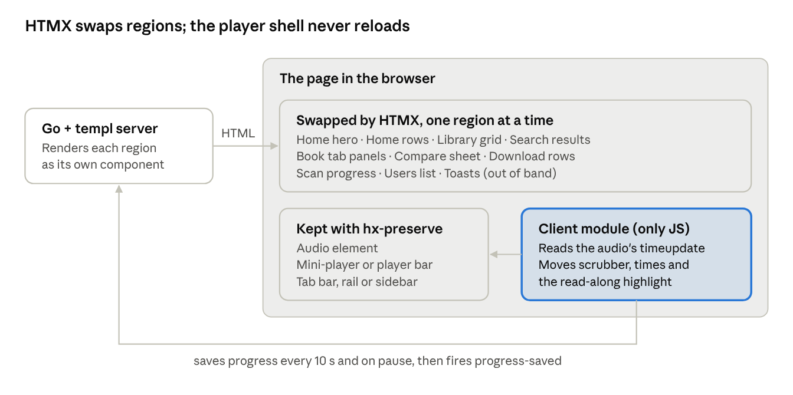

# Tendshelf — Developer handoff

Exported Nov 1, 2026 from the Claude Docs handoff.

## How to use this handoff

Build from two sources: the [screens canvas](https://claude.ai/artifact/KXfHbFsyKpv3K7xfVqnZSw) shows every screen, and the [Tendshelf Design System](https://claude.ai/artifact/64fwa6bjmdTQn8KJtgbh4P) holds the tokens, the `ts-` component classes and their markup. This doc covers what the pictures can't: the grid, what stays on screen, motion, which regions HTMX swaps, accessibility and the exact words.

Load `tokens.css`, the Google Fonts link, then `components/bundle.css`, and set `data-theme` on `<html>` (`dark`, `light`, `sepia` or `contrast`). There is no JavaScript bundle; the only client code is the player module described below.

| Canvas page | What it holds |
| --- | --- |
| Directions | The two moodboards (A Lamplight, B Walnut & Ember) and their sample screens. B was chosen. |
| Core | Home, Book detail and Player on phone, tablet and desktop, each in dark and light, plus the compare sheet. |
| Browse | Library (grid, list, filters, empty, scanning), Search, Series, Author, Narrator, Bookmarks, Downloads. |
| People | First-run setup, Rosa's invite and first home, Share & invite, Settings, Profile. |
| Admin | Users, Libraries with problems, the Research door and the Research lab. |
| States | Loading, offline, server error, no results, and the player's hints and sleep timer. |

The example people are fictional and recur on every page:

- **Daniel** runs the server and owns about 900 books. He is the admin in every admin screen.
- **Maya** listens on her commute. Most phone screens are hers.
- **Rosa** is 71 and joined from Daniel's invite link. Her screens use the light theme and larger text.
- **Inés** is a pending invite in the users list.

## Layout grid per breakpoint

Three breakpoints, one 8px spacing grid. Layouts reflow with browser zoom and text size; nothing truncates the time left.

| Breakpoint | Width (px) | Designed at | Columns | Gutter and margin | Navigation | Cover grid | Player |
| --- | --- | --- | --- | --- | --- | --- | --- |
| Phone | 360–767 | 390 × 844 | 4 | `space-20` | Bottom tab bar, 72 tall | 3 columns | Full screen; mini-player floats 8 above the tab bar |
| Tablet | 768–1279 | 1024 × 768 | 8 | `space-24` | Side rail, 88 wide | 5–6 columns | Full screen or split; mini-player at the bottom of the content area |
| Desktop | 1280+ | 1440 × 900 | 12, content max 1200 | `space-32` | Sidebar, 264 wide | 7–8 columns | Bottom player bar; opens a 400-wide side panel or the two-column full player |

- Descriptions and any running text stop at `size-measure` (68ch).
- Spacing tokens run `space-4` to `space-64` in 8px steps, with 4, 12 and 20 as half steps.
- Large-text mode (Rosa's setting) turns shelf spines into grid cards and stacks the player's settings bar into two rows.
- Tablet shows 5 cover columns below 900 wide and 6 from 900 up; the rail stays in both.

## Persistent elements

One rule above the rest: a screen never shows two buttons that resume the same book.

**Mini-player (phone and tablet)**

- Shows whenever a book is loaded, on every page except the full player.
- Hidden while Home's Continue listening hero is on screen, or any other primary button that resumes the same book. It slides back in once that button scrolls out of view.
- Tap opens the full player. Swipe up opens it too; swipe down on the full player closes it.
- Long-press opens the speed choices.
- Carries the cover, title, chapter, a thin progress line, play/pause and Back 30 seconds. It stays ember; it never takes the cover accent.
- Lives outside the swapped region with `hx-preserve`, so it never flickers on navigation.

**Desktop player bar and side panel**

- The bar sits at the bottom of every page once a book is loaded: cover, title, chapter, scrubber, controls, speed, sleep and volume.
- Opening the player shows a 400-wide side panel on wide pages, or the two-column full player on the book's own page.
- The one-resume rule applies here too: on Home the bar stays hidden while the hero's Resume is on screen. On another book's page the bar stays, because that page's button ("Listen again", "Start listening") plays a different book.

**The audio element** sits once at the root, outside every swap, and is never recreated during a session.

## Motion spec

Quick and calm, nothing bounces. Every value below is a token in the design system.

| Moment | Duration | Easing | What moves |
| --- | --- | --- | --- |
| Mini-player → full player | 250 ms (`duration-slow`) | `easing-expand` cubic-bezier(0.2, 0.9, 0.1, 1) | The cover is a shared element: it grows from 48 px to hero size and gains page edges and `shadow-cover` as it lands. The background fades from `raised` to the cover-tint fade. Title and controls fade in and rise 12 px, starting 80 ms in. |
| Full player → mini-player | 250 ms, or follows the finger | `easing-exit` | The same, reversed. Swiping down tracks the finger; released under 30% of the travel, it snaps back open. |
| Page change (HTMX swap) | 200 ms (`duration-base`) | `easing-standard` | Old content fades out; new content fades in with a 4 px rise. Navigation, mini-player and audio never move. |
| Sheets and toasts | 200 ms | `easing-enter` in, `easing-exit` out | Sheets rise from the bottom; toasts fade and rise 8 px. |
| Hover and selection | 150 ms (`duration-fast`) | `easing-standard` | Colour and background only. |
| Progress rings and bars | 600 ms (`duration-ring`) | `easing-standard` | Ease to the new value when it changes. |
| Scrubber while playing | continuous | linear | The needle moves smoothly; time labels change once per second. |
| Read-along highlight | 120 ms (`duration-highlight`) | `easing-standard` | The sentence wash cross-fades; the word emphasis slides word to word without jitter. |
| Hints ("Rewound 5 s after your break") | 150 ms in, 1.6 s hold, 150 ms out | `easing-standard` | Fade only. |
| Sleep timer ending | last 10 s | linear | Volume fades to zero and the card counts down. Shaking the phone or tapping "+10 min" restores it at once. |
| Scan and download progress | 600 ms | `easing-standard` | Bars ease; new covers fade in as they are found. |

**Reduced motion** (`prefers-reduced-motion: reduce`): every transition becomes a 150 ms cross-fade, the shared-element cover growth becomes a fade, loading shimmer and equalizer bars stop, and the read-along highlight snaps instead of sliding.

## Server-rendered partials (HTMX)

Each region below is its own templ component and swaps alone. The routes are suggestions; keep the targets and triggers.

Only the regions in the top box are replaced; the audio and controls below them survive every navigation.

| Region | Target | Trigger | Suggested route | Notes |
| --- | --- | --- | --- | --- |
| Continue listening hero | `#home-hero` | load, and `progress-saved` event | `GET /home/hero` | Shows the last book or the empty first-run card. |
| Each Home row | `#row-{name}` | load, `revealed` for rows below the fold | `GET /home/rows/{name}` | Recently added, Continue series, Finished, Shared with you. |
| Library grid | `#library-grid` | change on filters, sort and view toggle | `GET /library?…` with `hx-push-url` | Grid or list; filters live in the URL so Back works. |
| Search results | `#search-results` | `input changed delay:150ms` | `GET /search?q=` | Groups: books, series, authors, narrators. Shows "did you mean" on no results. |
| Book tab panels | `#book-panel` | click on a tab | `GET /books/{id}/{tab}` with `hx-push-url` | About, Chapters, Bookmarks, Details. |
| Compare sheet | `#sheet` | click "Look up details online" | `GET /books/{id}/compare` | "Use 2 changes" posts back and re-renders Details. |
| Download rows | `#download-{id}` | every 1 s while downloading (`hx-trigger="every 1s"` until done) | `GET /downloads/{id}` | Stops polling when the server returns the finished row. |
| Scan progress | `#scan` | every 1 s while a scan runs | `GET /admin/libraries/scan` | New covers stream into the library grid out of band. |
| Users list | `#users` | after invite, revoke or role change | `GET /admin/users` |  |
| Toasts | `#toasts` | out of band on any response | `hx-swap-oob` | `role="status"`; errors use `role="alert"`. |

**Kept out of every swap** with `hx-preserve`: the `<audio>` element, the mini-player or desktop player bar, and the navigation (tab bar, rail or sidebar).

**The client module** (the app's only JavaScript, roughly one small file):

- Listens to the audio's `timeupdate` and drives the scrubber needle, the elapsed and remaining times, chapter changes and the read-along highlight.
- Saves progress to the server every 10 seconds and on pause, then fires `progress-saved` so the hero and rings refresh.
- Handles media keys, the Media Session API (lock screen controls and artwork), the sleep timer fade and the "rewound after your break" rule.
- Keeps downloaded books playable offline and queues progress saves until the server is reachable.

## Accessibility per component

Target WCAG 2.2 AA in every theme; the `contrast` theme meets 7:1 for text. Every target is at least 44 px (`size-tap`), focus is always the one `focus-ring`, and colour never carries meaning alone.

| Component | Element and role | Name and state | Keyboard |
| --- | --- | --- | --- |
| Button, IconButton | `<button>` | Icon-only buttons carry an `aria-label` naming the action: "Back 30 seconds", "Bookmark this moment". | Enter, Space |
| Play/pause (80 px) | `<button>` | Label switches "Play" / "Pause" with the title: "Pause The Lighthouse Keeper's Daughter". | Space anywhere on the player page |
| Scrubber | `<input type="range">` under the drawn ruler | `aria-valuetext="2 h 14 min of 8 h 52 min, chapter 12"`, updated no more than once per 10 s for screen readers. | ← / → skip, Home / End |
| Segmented control, option sheets | `role="radiogroup"` with `role="radio"` items | `aria-checked`; the selected item also gets a check. | Arrow keys move and select |
| Tabs (book page) | `role="tablist"`, `tab`, `tabpanel` | `aria-selected`, `aria-controls`; the panel swap keeps focus on the tab. | Arrow keys, Enter |
| Switch | `<button role="switch">` | `aria-checked`; the label says what turns on ("Watch this folder for new books"). | Space |
| Chip (filters) | `<button aria-pressed>` | Selected chips gain a check icon. | Enter, Space |
| Text field, search | `<input>` with a visible `<label>` | Errors tied with `aria-describedby`; search results count announced politely. | / focuses search on desktop |
| Mini-player, player bar | `<section aria-label="Now playing">` | The open link names book and chapter: "Open player: The Cartographer's Silence, chapter 6". | Tab order: open, play/pause, Back 30 |
| Sheet | `role="dialog" aria-modal="true"` | Labelled by its title; focus moves in and returns on close. | Esc closes |
| Toast | `role="status"` (errors `role="alert"`) | Undo actions stay 6 s, longer if focused. | Reachable by Tab while shown |
| Progress ring, bar | `role="progressbar"` | `aria-valuetext` in words: "62% listened, 3 h left". | None |
| Book card, chapter row | `<a>` or `<button>` holding the whole row | Played chapters get a check and "played" in the name. | Enter |
| Cover | `` | Alt is the title only; decorative covers in lists use `alt=""` when the title is next to them. | None |
| Waveform, cover tint | Decorative | `aria-hidden="true"`; the waveform shows no progress. | None |

**Desktop keys:** Space play/pause, ← / → skip, B bookmark, / search, G then L library, G then H home. A "?" sheet lists them.

**Large text:** follow the browser's text size and the in-app setting; spines turn into cards, the player's settings bar stacks into two rows, and nothing truncates the time left.

**Reduced motion:** see the motion spec. **Screen reader order** on the player: title, chapter, time left, play/pause, skip, scrubber, then settings.

## Copy deck

Sentence case, verbs on buttons, no exclamation marks, no emoji, no "Oops". Say "book", "chapter", "folder" and "invite" in the listening app, never "item", "track", "library root" or "token". `{braces}` are filled in by the server.

**Buttons**

| Where | Label | Does |
| --- | --- | --- |
| Home hero, book page | Resume | Plays from the saved place. |
| Book page, not started | Start listening | Plays from chapter 1. |
| Book page, finished | Listen again | Plays from the start; keeps bookmarks. |
| Home row, series page | Continue series / Start series | Plays the next unfinished book. |
| Player | Bookmark this moment | Adds a bookmark; toast offers "Add a note". |
| Book page, Details tab | Look up details online | Opens the compare sheet. |
| Compare sheet | Use {n} changes | Applies the ticked fields. |
| Share & invite | Invite someone / Create invite link | Starts an invite; makes a link to copy. |
| Users | Stop sharing | Revokes access after a confirm. |
| Libraries | Scan now / Add a folder | Rescans; picks a new folder. |
| Error states | Try again | Repeats the last request. |
| No results | Clear search | Empties the field. |
| Sleep timer | +10 min | Extends the timer. |
| Research door | Turn on Research | Enables the admin-only lab. |

**Empty states**

| Where | Title | Body |
| --- | --- | --- |
| Library, first run | Your shelf is empty | Point Tendshelf at a folder of audiobooks and they'll appear here. Button: Add a folder |
| Shared with you | Nothing shared yet | When someone shares a book with you, it shows up here. |
| Search | Nothing for “{query}” | Check the spelling, or try an author or narrator. Offers "Did you mean {suggestion}?" |
| Downloads | No downloads yet | Download a book to listen without a connection. |
| Bookmarks | No bookmarks yet | Tap the bookmark button while listening to save a moment. |

**Errors, banners and hints**

- Offline banner: "You're offline. Downloaded books still play, and your place is saved."
- Server unreachable: "Couldn't reach your server. Downloaded books still play." Button: Try again. Expander: "Details to show {admin name}".
- Player hints: "Rewound 5 s after your break" · "Bookmarked at {time} · Add a note" · "Sleeping in {n} seconds".
- Where you are: "Chapter {n} · {m} min left in chapter · {h} h {m} m left in book".
- Invite line: "{name} invited you to listen to {title} and {n} other books."
- Privacy: "Tendshelf sends nothing about you anywhere. No telemetry."
- Libraries summary: "{n} books ready to play".
- Research door fair-practice note: "Only files you own, already on this server. Copy-protected files are refused."

## Cover accent and theme rules

Inside the player only, the current cover lends its colour; everywhere else the chrome stays ember. Compute both values on the server when a cover is scanned, store them with the book, and set them as inline variables on the player root.

1. Sample the cover's dominant colour, ignoring near-black, near-white and very small areas. That colour is `--cover-tint`.
2. Convert it to OKLCH and cap chroma at 0.10.
3. Set lightness per theme to make `--cover-accent`, then check it: the play button's text must reach 4.5:1 and the scrubber fill 3:1 on its ground.
4. No usable colour (a grey or text-only cover, or a failed check): both fall back to ember (`accent`) and `surface`.

| Theme | Accent lightness | Text on accent (`on-cover-accent`) | Background tint | Example (teal cover) |
| --- | --- | --- | --- | --- |
| Dark (default) | 0.75–0.85 | Charcoal | `cover-tint` at 70%, fading to `ground` by 60% of the height | #9CCBC4 |
| Light | 0.38–0.46 | White | About 25%, same fade | #2C6660 |
| Sepia | 0.38–0.46 | White | About 25%, same fade | #2C6660 |
| Contrast | White | Black | None | #FFFFFF |

Other tested pairs (dark / light): moss #B8CB9A / #4B6338, rust #F0A27E / #9A3D1D, plum #C7B3E0 / #5B4677.

**Only these take the cover accent:** the play/pause button, the scrubber fill, needle and current-chapter line, the "left in chapter" label and the background fade. Tabs, the mini-player, links and every other button stay ember.

**Theme switching:** set `data-theme` on `<html>`. Default to the system's light or dark preference; the user's choice in Settings wins and is saved on the server so it follows them across devices.

**Research lab** ignores the reading themes and always uses its own `lab-*` tokens: a cooler ground, Fira Mono for figures and paths, 4–8 px corners, no covers' page edges, tints or shadows. Its two data colours, `lab-data` #3d9bd6 and `lab-moment` #c4802e, pass colour-vision separation on `lab-surface`; moments always carry a numbered flag as well.

## Read-along reader

A book can hold an audiobook, an ebook, or both. Once the owner pairs them and the server aligns them, the same book and the same player offer **Listen**, **Read along** and **Read**, all sharing one position. Screens are on the canvas's **Read along** page; tokens and the 12 reader components are in the design system.

**What swaps on the server, what the client does**

| Part | Who renders it | Target and trigger | Notes |
| --- | --- | --- | --- |
| Chapter text | Server partial, one per chapter | `#reader-text`, `GET /books/{id}/read/{chapter}`; next chapter loads `revealed` near the end | Every sentence is ``, every word ``, times from the alignment file. |
| Mode switcher | Server, with `hx-push-url` | `GET /books/{id}?mode=listen\|readalong\|read` | Swaps the reader body only; the audio keeps playing. |
| Reading settings | Server form, live | `hx-put /me/reading` on `change`, `hx-swap="none"` | The client applies `--read-size`, `--read-leading`, `data-hl` and the theme at once; the server saves them per person. |
| Contents and notes panels | Server partials | `#reader-panel`, on open | Same panel markup on phone (sheet) and desktop (side panel). |
| Highlights and notes | Server, out of band | `hx-post /books/{id}/marks`, response swaps the sentence's span and the count | One set per book; each stores sentence id, audio time and page. |
| Alignment progress | Server partial | `#align`, `every 2s` until done | Finished state also sends a toast out of band. |
| Sentence and word highlight | Client module | `timeupdate` on the shared audio | Sets `is-now` on one `.ts-s` and one `.ts-w`; binary search over the chapter's spans. |
| Follow the voice and the pill | Client module | Intersection observer on the current sentence | Auto-scroll keeps it in the top third over 400 ms; when it leaves the view by user scroll, following stops and "Back to the voice" appears. |
| Read-along dock | `hx-preserve`, like the mini-player | none | Same audio element; skip buttons move by sentence. |

**Text layout rules**

- Column at most `size-read-measure` (68ch), never below 45ch on tablet and desktop; on phones the screen minus 24 px each side.
- Fraunces at 18, 20 (default) or 22 px; large-text mode adds 26. Line spacing 1.45, 1.6 (default) or 1.8. Sans is an option.
- Left-aligned, hyphenated, `text-wrap: pretty`, no justification. Paragraphs indent 1.4em with no gap; the first paragraph of a chapter gets a drop cap.
- Page numbers come from the EPUB's page list when it has one, otherwise from 1,800-character pages, and stay the same on every device.
- Text only parts (forewords, author's notes) are marked "text only, not narrated" in contents; read-along skips them.

**Reader motion**

| Moment | Duration | What moves |
| --- | --- | --- |
| Sentence highlight | 120 ms (`duration-highlight`) | The wash cross-fades to the next sentence; the word underline steps word to word with no easing. |
| Follow the voice | 400 ms (`duration-follow`), `easing-standard` | The page scrolls to keep the current sentence in the top third. Never while a finger is down or a selection is open. |
| Back to the voice pill | 200 ms (`duration-pill`) | Fades and rises 8 px in when following stops; out when the voice is back in view. |
| Listen → Read along | 250 ms, `easing-expand` | The player cover shrinks into the dock while the text fades in and rises 12 px. Reverse for Read along → Listen. |
| Read along → Read | 200 ms | The dock slides down into the thin progress footer; the wash fades out. |
| Focus line | 200 ms | The next sentence slides up into the centre as the previous one fades. |
| Reading settings | instant | Changes apply to the preview and the page behind at once. |

Reduced motion: the highlight snaps, follow jumps, every mode change is a 150 ms fade.

**Reader edge states** (canvas, bottom of the Read along page):

- No matching audiobook: "Which audiobook is it?", close matches to choose from, or "Keep it as an ebook on its own".
- Copy-protected file: "This ebook is copy-protected", nothing stored, "Choose another file"; the audiobook keeps working.
- Alignment stopped partway: "Read along stopped at chapter 14", chapters before it stay ready, "Try again" or "Choose another ebook"; after that chapter the voice plays and the text stays still.
- Large text (Rosa): 26 px, Airy spacing, 52–56 px targets, and Back and Next buttons with words instead of icons.

**Accessibility**

- Real `
` and headings; screen readers move by paragraph. The highlight is visual only and never announced.
- The highlight never relies on the wash alone: the word underline is on by default, and Underline style exists for anyone who can't see the wash. Brighten keeps the rest at 6:1 or better.
- Your highlights pair a gold wash with a gold underline; selection is blue so it never looks like a highlight.
- Mode switcher and every settings row are `role="radiogroup"`; switches are `role="switch"`; the selection menu is a `role="toolbar"`; note bubbles are dialogs that return focus to their dot.
- Eyes-free uses three huge targets and no text to follow. Focus line shows one sentence at 24 px.
- Reduced motion: the highlight snaps, auto-follow jumps, mode changes fade.

**Desktop keys:** Space play/pause, J / K previous and next sentence, ← / → back and forward 30 s, H highlight the current sentence, N add a note, F back to the voice, R switch mode.

**Copy:** "Add an ebook" · "Pair and prepare read-along" · "Not the same book" · "Preparing read-along" · "Read along works up to chapter {n} for now" · "Read-along is ready for {title}" · "Continue reading along" · "Continue reading from p. {n}" / "Continue listening from {time}" · "Back to the voice" · "Listen from here" · "Also let them read along" · "Ready offline: listen, read, read along" · "You're offline. This book is downloaded, so you can listen, read and read along."

## Still to come

The read-along reader is now designed and documented above. What's left is open questions.

- [x] Reader screens on phone, tablet and desktop, the hero in dark, light and sepia.
- [x] Reader tokens and components in the design system.
- [x] Reader motion, partials, layout rules and keys.

**Open questions**

- Does the server compute the cover accent at scan time, or on first play? This doc assumes scan time.
- Should progress saves every 10 seconds be configurable for very large households?
- Decided: the TV app gets its own layouts and its own look, in the spirit of Apple TV and LG apps, not a scaled-up phone or web page. Not designed in this package.
