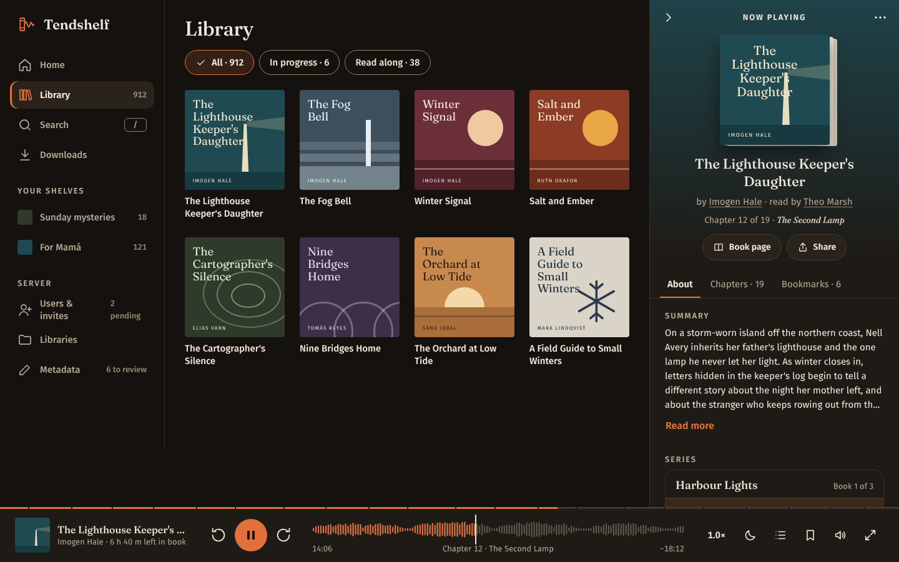

# Now playing panel: book details instead of a second player

**For:** the coding agent working in the Tendshelf repo (Go + templ + HTMX, plain CSS).
**Goal:** the 400px panel that opens on the right of desktop pages stops being a second player. The player bar along the bottom keeps every control; the panel becomes the place to read about the book: summary, series, author, narrator, details, chapters and bookmarks.

## What's wrong now

See `screens/00-current-desktop.png` and `screens/00-current-empty-panel.png`.

1. **The same book has three sets of controls.** The Home hero has Pause, the side panel has a full transport with a 92px pause, and the player bar has its own. They all do the same thing.
2. **The panel is mostly empty.** Below its controls is a tall blank area (the second screenshot).
3. **"Chapter 13 · Chapter 13".** When a chapter has no real title, the file's "Chapter 13" gets printed after "Chapter 13". This shows in the bar and in the panel.

## The design

The panel keeps its place and size: 400px (`--size-player-panel`), between the top of the window and the 88px bar. It also keeps the cover tint fading down from the top, like the full player; the bar below stays ember.

**Top to bottom:**

| Part | What it shows |
| --- | --- |
| Header, 56px, fixed | Close (›), "Now playing", and a ⋯ menu: add to shelf, mark as finished, download. Once the big cover scrolls away, "Now playing" is replaced by a 32px cover and the title (`.is-scrolled`). |
| Hero (scrolls) | 176px cover with page edges. Title in Fraunces 22, up to two lines. "by Author · read by Narrator", each a link; several of either are listed with commas. The current chapter ("Chapter 12 of 19 · *The Second Lamp*"). Two secondary buttons: Book page, Share. **No play button, scrubber, clock or skip buttons**: those are the bar's. |
| Tabs (sticky) | About · Chapters · 19 · Bookmarks · 6. They stick to the top of the scroll area under the header. |
| Tab body | See below. |

The whole panel below the header is **one scroll area**. There are no nested scrollbars.

### About tab

The sections, in this order:

1. **Summary:** six lines, then "Read more" expands it in place ("Show less" collapses it).
2. **Series:** a card with the series name (link) and "Book 1 of 3", then every book in the series as a row: number, 44px cover, title, and a state line. The states are "You're here · 62%" (this book, highlighted, ember), "Up next · 15 h 10 m", "Finished", or "Not started · 16 h 02 m". Each row links to that book.
3. **Details:** a two-column list (labels 112px, 13px muted; values 15px).

   | Label | Value |
   | --- | --- |
   | Written by | Avatar with initials, then the name (link) |
   | Read by | Avatar with initials, then the name (link); one row per narrator |
   | Published | Publisher · year, with "Unabridged" or "Abridged" under it |
   | Length | 17 h 32 m · 19 chapters |
   | Formats | Audiobook and ebook, with "Read along is ready" under it when it is |
   | Language | English |
   | On the shelf | Added 12 September 2026, with "by Daniel, from Audiobooks / Hale" under it |

4. **Genres:** chips that link to the filtered library.
5. **"Also read by {narrator}":** three covers. Use "More by {author}" when the narrator has nothing else on the shelf, and leave the section out if neither has.

**Missing data:** leave the row or section out. Never print "Unknown", "—" or an empty label. With no summary, show a dashed box reading "No description for this book yet." Admins also get "Look up details online", which opens the existing compare sheet. See `screens/NPSparse.png`.

### Chapters tab

The existing chapter rows (`.ts-chapter`): number, title (italic serif), duration, and a state. Played chapters get a check, the current chapter the equalizer and "18:12 left". When the tab opens, it scrolls to the current chapter. Played chapters before the last three fold into "Chapters 1 to 8 played · Show". A click plays from the start of that chapter. See `screens/NPChapters.png`.

### Bookmarks tab

The existing bookmark rows (`.ts-mark`), newest first: chapter and time, when it was made, the quote, the note, and "Play from here". There's a link to "All 6 bookmarks and notes" at the end. See `screens/NPBookmarks.png`.

### Other states

| State | Screen |
| --- | --- |
| Scrolled (compact header, sticky tabs) | `screens/NPScrolled.png` |
| Light theme | `screens/NPLight.png` |
| Anatomy | `screens/NPAnatomy.png` |

## Fixes that come with it

- **One set of controls.** Remove the transport, big clock and scrubber from the panel. On Home, follow the existing one-resume rule: while the Continue listening hero shows the book that's already loaded, that hero shows "Now playing" and a "Show player" button that opens this panel, instead of a second Pause. The bar keeps its play/pause.
- **Chapter line.** Use `ChapterLine(index, count, title)` from `templ/now_panel.templ`. If the title is empty, or equals "Chapter N" or "N", print only "Chapter 13 of 27". Apply the same rule in the bar's "Chapter 13 · …" line.

## HTMX

| Region | Request | Swap |
| --- | --- | --- |
| Whole panel | `GET /player/panel/{bookID}` when the panel opens and when the playing book changes | `#now-panel`, `outerHTML` |
| About tab | `GET /player/panel/{bookID}/about` | `#now-panel-tab`, `innerHTML` |
| Chapters tab | `GET /player/panel/{bookID}/chapters` | `#now-panel-tab`, `innerHTML` |
| Bookmarks tab | `GET /player/panel/{bookID}/bookmarks` | `#now-panel-tab`, `innerHTML` |

- The tab buttons carry those `hx-get`s (see `panelTab` in the templ file).
- When a bookmark is added from the bar, return the Bookmarks tab count out of band so the tab label updates.
- When the chapter changes, refresh the hero's chapter line and the Chapters tab if it's open: fire an event from the player module and listen for it with `hx-trigger="tendshelf:chapter from:body"`.
- The panel is **not** `hx-preserve`; it's server content and can swap. The bar and `<audio>` stay preserved as before.

## Files

| File | What it is |
| --- | --- |
| `templ/now_panel.templ` | Reference component: `NowPanel`, `NowPanelAbout`, `ChapterLine`, and the props types. Builds with templ v0.3.906. `now_panel_test.go` renders it, checks the "Chapter 13" rule and checks that empty rows are left out. Map the props from your book, series, person and bookmark models. |
| `css/now-panel.css` | The new CSS only. `css/tokens.css` and `css/bundle.css` are the full design-system files with it included. |
| `js/now-panel.js` | About 50 lines, no dependencies: the compact header on scroll, Read more, tab keyboard (← / →) and selected state, and scrolling to the current chapter after the Chapters tab loads. |
| `screens/` | Your two screenshots, the desktop view with the panel open, the anatomy, and every tab and state. |

## Accessibility

- The panel is `<aside aria-label="Now playing: about this book">`.
- Tabs are `role="tablist"`/`tab`/`tabpanel`, with `aria-selected` kept in sync. ← / → move between tabs.
- "Read more" is a button with `aria-expanded` and `aria-controls`.
- The current series book and chapter use `aria-current="true"` and get a word ("You're here", "18:12 left"), so the highlight never relies on colour alone.
- Details is a real `<dl>`.
- Every target is at least 44px, except the inline links inside the byline, which follow text size.
- Reduced motion: scrolling to the current chapter jumps instead of animating.

## Steps

1. Add `now-panel.css`.
2. Build `NowPanel` and its tab partials and routes; map the props to your data.
3. Replace the panel's player controls with the new component.
4. Apply the chapter-line rule in the panel and the bar.
5. Change the Home hero for the playing book to "Now playing" with "Show player".
6. Add `now-panel.js`.
7. Check the list below in dark, light, sepia and high contrast.

## Done when

- [ ] With a book playing on desktop, the only play/pause controls are in the bar.
- [ ] The panel has no empty area: the tab content fills it and the whole panel scrolls as one, with the tabs sticking and the header swapping to the small cover and title.
- [ ] About shows the summary (with Read more), the series with every book and its state, details, genres, and more by the narrator or author. Rows with no data are absent.
- [ ] A book with a series shows "Book N of M", and the current book is highlighted with "You're here · {progress}".
- [ ] A book without a summary shows the empty box, and admins see "Look up details online".
- [ ] No "Chapter 13 · Chapter 13" anywhere.
- [ ] The Chapters tab opens scrolled to the current chapter; the Bookmarks tab count updates when a bookmark is added from the bar.
- [ ] The tabs work with the keyboard, and a screen reader announces the tab names and the current chapter.
