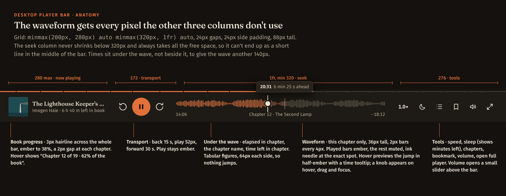

# Desktop player bar: waveform redesign

**For:** the coding agent working in the Tendshelf repo (Go + templ + HTMX, plain CSS).
**Goal:** replace the desktop player bar (1280px and wider) with the design in `screens/`. Its seek control becomes a waveform of the current chapter that always fills the free width of the bar.

Open `prototype/index.html` in a browser first. It's a working version of the bar with simulated audio: play, hover, click, drag, the keyboard, resizing and the four themes all behave as specified here.

## What's wrong now

See `screens/00-current-bug.png`.

1. **The scrubber is a short line that starts halfway across the bar.** On a 1960px window it runs from about x=955 to x=1405, about 450px, while ~600px of empty bar sits to its left. The seek control isn't getting the free space.
2. **It's a thin line** that says nothing about the audio and is hard to hit.
3. **There's no time readout** next to the scrubber, so you can't tell where you are in the chapter.
4. **The controls are duplicated.** A boxed Speed / Sleep / Chapters / Bookmark panel floats in the page content, above the bar, while the bar has its own speed and sleep buttons. That panel belongs only in the full player.

Likely causes to check before rewriting: a fixed `width` or `max-width` on the scrubber or its wrapper; the scrubber in a flex item without `flex: 1` and `min-width: 0`; or `justify-content: space-between` spreading three fixed-size groups so the middle one floats. The new layout below uses CSS grid with a `1fr` seek column, which avoids all three.

## The design



One row, 88px tall (`--size-pbar`), background `--surface`, a 1px `--line` top border. It's laid out as a four-column grid:

```css
grid-template-columns: minmax(200px, 280px) auto minmax(320px, 1fr) auto;
column-gap: 24px; padding: 0 24px;
```

| Column | Contents |
| --- | --- |
| Now playing (200–280px) | 56px cover, title (Fraunces 16, one line, ellipsis), "Author · 6 h 40 m left in book" (13px, muted). The whole block links to the full player. |
| Transport (auto, ~172px) | Back 15 s, Play/Pause (52px ember circle), Forward 30 s. |
| **Seek (1fr, at least 320px)** | The chapter waveform, 36px tall. Under it, one 18px row: elapsed in chapter (left), "Chapter 12 · The Second Lamp" (centre, ellipsis), time left in chapter (right, ember). Times sit in fixed 64px tabular cells so the wave never shifts. |
| Tools (auto, ~276px) | Speed ("1.0×" text button), Sleep (shows "18m" in ember while set), Chapters, Bookmark, Volume (opens a small slider above the bar), Open the full player. |

**Book progress** is a 3px hairline along the bar's top edge: `--line` track, `--accent-fill` to the book position, and a 2px `--surface` gap at each chapter start. On hover it shows "Chapter 12 of 19 · 62% of the book".

From 1280 to 1365px the grid tightens: `column-gap: 16px`, and the now-playing column becomes `minmax(180px, 240px)`. Below 1280 the existing tablet layout takes over, with the mini-player instead of this bar.

The bar stays ember, like the mini-player. It does **not** take the cover accent; only the full player does. Hide the bar on Home while the Continue listening hero, which resumes the same book, is on screen. That's the existing one-resume rule.

## The waveform

| State | Screen |
| --- | --- |
| Playing | `screens/PBarPlaying.png` |
| Hover ahead: preview a jump | `screens/PBarHover.png` |
| Hover behind the needle: go back | `screens/PBarHoverBack.png` |
| Dragging | `screens/PBarDrag.png` |
| Paused, sleep timer on, light theme | `screens/PBarPausedLight.png` |
| Loading (values not ready) | `screens/PBarLoading.png` |
| 1280 wide | `screens/PBarNarrow.png` |
| Sepia, high contrast | `screens/PBarSepia.png`, `screens/PBarContrast.png` |

- **It shows the current chapter only.** A whole 17-hour book is too long to scrub precisely, and its waveform would be noise. The book hairline above covers the whole book.
- **Bars:** 2px wide, one every 4px, round caps, centred vertically in 36px. The bar count is `floor(width / 4)`, recomputed on resize with a `ResizeObserver`.
- **Shape:** each bar is the mean loudness of its slice of the chapter. The values are then stretched per chapter, so the quietest tenth sits at 20% height and the loudest bar at full height. Steady narration is nearly flat in absolute terms, so the stretch shows its shape (pauses, scene breaks, raised voices) rather than decibels. The code is in `js/player-bar.js`, `wavePath()`.
- **Colours** (new tokens, all four themes, in `css/tokens.css`):

  | Token | Used for |
  | --- | --- |
  | `--wave-played` | Bars before the needle, at 5:1 or better on surface. |
  | `--wave-rest` | Bars after the needle. Quieter; at least 2:1 against the played bars. |
  | `--wave-ahead` | Hover preview between the needle and the pointer. |

  The needle is 2px of `--ink`, standing 6px above and below the wave, so the exact position never depends on colour.
- **The structure is three copies of one path.** Rest underneath, played clipped to `--p`, then the hover-ahead and hover-behind layers clipped between `--p` and `--h`. One CSS variable moves the whole thing; nothing is redrawn while playing. See `css/player-bar.css`.

## Interaction

| Input | Result |
| --- | --- |
| Hover | Hairline at the pointer; bars between the needle and the pointer turn `--wave-ahead`, or back to rest when hovering behind the needle. A knob (14px ink circle) appears on the needle. A tooltip above shows the target time and how far: "20:31 · 6 min 25 s ahead" or "3:33 · 10 min 33 s back". |
| Click | Jumps to that point. |
| Press and drag | The needle and times follow the pointer, and the tooltip reads "20:40 · chapter 12". Audio jumps on release. Uses pointer capture, so dragging outside the wave keeps working. |
| Tab to the wave | Focus ring around the wave and the knob shows. ← / → or ↓ / ↑ 5 s, Page Down / Page Up 30 s, Home / End the chapter's start and end. |
| Screen readers | A real `<input type="range">` covers the wave (opacity 0). Its `aria-label` is "Position in chapter 12"; its `aria-valuetext` is "14 minutes 6 seconds of 32 minutes 18 seconds, chapter 12, The Second Lamp", updated on focus, on key presses and otherwise at most every 10 s. |
| Chapter ends | Load the next chapter's values; the wave shows flat bars until they arrive. |
| Reduced motion | No loading pulse, and the knob and tooltip appear without transitions. |

Global desktop keys stay as they are: Space play/pause, ← / → skip (when focus isn't in the wave or a field), B bookmark.

## Loudness values from the server

`go/waveform/` is a tested reference package: `go test ./...` passes, and the ffmpeg test makes a real tone-then-silence file.

- **Compute once per book, in the background, after a scan:** `waveform.Peaks(ctx, path)` for a single-file book, or `waveform.PeaksForFiles(ctx, paths)` for a book made of several files in book order. It decodes with ffmpeg to 8 kHz mono and returns one byte per 1/5 s: RMS loudness, with the book's 95th percentile at 255, square-rooted. A 17-hour book is about 300 KB.
- **Store** with `waveform.Store{Dir: <data dir>/peaks}.Save(bookID, peaks)`, or put the bytes wherever Tendshelf keeps derived data.
- **Serve** `GET /books/{id}/peaks?from=<s>&to=<s>`, where from and to are book seconds for the chapter:
  - **200** `application/octet-stream`, one byte per 1/5 s, with an `ETag` and `X-Peaks-Rate: 5`.
  - **202** with `Retry-After: 3` while not computed yet. The client shows flat bars and retries.

  Register it with the same auth as the audio stream: `mux.HandleFunc("GET /books/{id}/peaks", store.Handler)`.
- **Existing books:** queue them all once after this ships. The bar works without values (flat bars), so there's no hurry.

## Client

`js/player-bar.js` has no dependencies and exposes `window.TendshelfPlayerBar.mount(el, opts)`. The bar is `hx-preserve`, so mount it once on page load:

```js
const el = document.getElementById('player-bar');
const audio = document.getElementById('audio');
const d = el.dataset;
const chapterFrom = (i, title, start, end) => ({ index: +i, title, start: +start, end: +end });
const bar = TendshelfPlayerBar.mount(el, {
  audio,
  chapter: chapterFrom(d.chapterIndex, d.chapterTitle, d.chapterStart, d.chapterEnd),
  peaksUrl: ch => `/books/${d.book}/peaks?from=${ch.start}&to=${ch.end}`,
  bookDuration: +d.bookDuration,
  onChapterEnd: ch => { /* look up the next chapter from your chapter list, then: */ bar.setChapter(next) },
});
```

It owns the waveform drawing, the needle, the times, hover, drag, keyboard, the skip buttons (`data-skip`), play/pause, and the book hairline width. Speed, sleep, chapters, bookmark and volume stay with your existing handlers. If the app already has a player module, fold this in rather than running two `timeupdate` loops.

## Markup

`templ/player_bar.templ` is a reference component. It generates and builds with templ v0.3.906, and a render test passes. Adapt `PlayerBarProps` to your models. The server renders the bar with the wave in its loading state and correct times; the client fills in the bars.

If you'd rather keep your own markup, keep these class names and parts, because the CSS and JS depend on them: `.ts-pbar`, `.ts-pbar__book-progress > span`, `.ts-pbar__play`, `.ts-wave` with its four `svg` layers (`__rest`, `__played`, `__ahead`, `__behind`), `.ts-wave__needle`, `.ts-wave__hoverline`, `.ts-wave__tip`, `.ts-wave__input`, and the `data-pbar="elapsed|chapter|left"` spans.

## CSS and tokens

- `css/player-bar.css` holds only the new rules. Add them to your `bundle.css`.
- `css/tokens.css` and `css/bundle.css` are the full design-system files with this change included. Diff them against yours: the additions are `--wave-played`, `--wave-rest`, `--wave-ahead` (per theme) and `--size-pbar: 88px`.

## Steps

1. Add the tokens and `player-bar.css`.
2. Replace the desktop bar's markup with the new structure (templ component or your own, with the class names above).
3. Remove the floating Speed / Sleep / Chapters / Bookmark panel from page content wherever the bar is showing.
4. Add `js/player-bar.js` and mount it. Wire `onChapterEnd` to your chapter list.
5. Add the `waveform` package, the background job after scan, the peaks route, and a one-off job for existing books.
6. Check every item below at 1280, 1440 and 1920 wide, in all four themes.

## Done when

- [ ] At 1280, 1440 and 1920 px the wave starts right after the transport and ends right before the tools; there's no empty band in the bar.
- [ ] Bars stay 2px every 4px at every width, and redraw on resize without stretching.
- [ ] Hovering previews ahead and behind, with the tooltip; a click jumps; drag-and-release jumps; dragging off the wave keeps working.
- [ ] Keyboard: Tab reaches the wave and shows the focus ring and knob; arrows, Page Up/Down, Home and End work; a screen reader announces the position in words.
- [ ] Times under the wave tick once a second and don't make anything shift.
- [ ] The book hairline matches book progress and shows a gap at each chapter.
- [ ] A book whose values aren't computed shows flat pulsing bars with "Drawing the waveform for chapter 12…", still scrubs, and fills in when the values arrive.
- [ ] No duplicate speed or sleep controls on the page while the bar is visible.
- [ ] Dark, light, sepia and high contrast match the screens; reduced motion removes the pulse and transitions.
- [ ] The bar never reloads or flickers on HTMX navigation (`hx-preserve`).

## Note

Earlier design notes said a waveform should be decorative and show no progress. That still holds for the decorative waveform elsewhere. For this bar, the waveform **is** the progress control, and these rules replace the old thin scrubber on desktop. The phone and tablet players keep their ruler scrubber for now.
